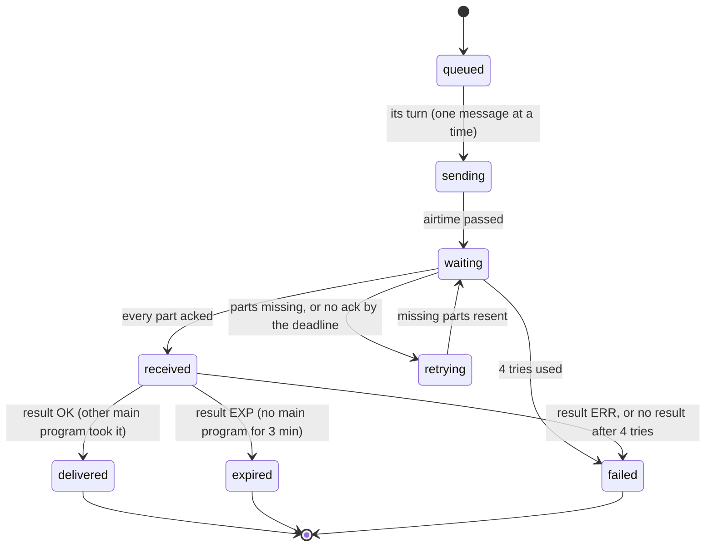

# Radio Connector: how ACKs work

How the Radio Connector makes sure a message arrives: the two protocol layers, the code that
runs the ACK cycle, and each message's states. The full protocol spec is
[connector-protocol.md](connector-protocol.md); hands-on tests are in
[rc1-test-messages.md](rc1-test-messages.md).

## Summary

ACKs only pass between two Radio Connectors (or a connector and something that speaks `RC1`,
such as the menu program in a test). Plain AX.25 text, like the menu program sending to `CQ`, is
heard and logged in `--verbose` mode, then ignored: `Engine::onFrame` only takes `RC1` frames
addressed to the connector's own callsign.

The cycle in one line: main program A sends `message.send` → connector A splits the text into
`RC1|D` parts → connector B collects them and replies `RC1|A` (which parts it has) → once B's
main program takes the message, B sends `RC1|R|OK` → connector A reports `delivered`. Main
program A sees every step as a `message.status` line.

## The protocol

There are two layers. The main program speaks JSON to its connector over TCP, and connectors
speak a compact text format to each other over the air.

**Design rule: the main program never sees the medium.** Every connector (radio, internet,
anything else) speaks the same Layer 1 interface to the main program. All medium-specific work
stays inside the connector: for radio that's direwolf, the air format, splitting, retries and
ACKs. In the final setup the other station's connector runs on a different computer, like VARA
HF/VHF, so each copy has its own settings file and callsign. The second copy on one PC is only a
test stand-in for that.

**Layer 1: suite JSON (main program ↔ connector).** One JSON object per line. The connector
dials out to the main program (`--main 127.0.0.1:9000`) and retries every 5 s. Every message uses
the same envelope:

```json
{"v":1, "type":"message.send", "id":"m-102", "re":null, "body":{"to":"K1ABC-3","text":"hello"}}
```

| Message | Direction | What it means for ACKs |
| --- | --- | --- |
| `message.send` | main → connector | Send this text to that callsign |
| `message.accepted` | connector → main | Reply with the new `msgId` (e.g. `N8GM/03F`) and part count |
| `message.status` | connector → main | Sent on every state change, with `partsAcked`. This is the ACK the client sees |
| `message.received` | connector → main | A whole message arrived from another station |
| `ack` | main → connector | Main took the message (`re` = its `id`). Triggers the `OK` result over the air |

**Layer 2: air format (connector ↔ connector).** Text in the AX.25 info field, fields split by
`|`. The AX.25 source is the sender and the destination is the addressed station. Anything
without the `RC1` tag, or not addressed to this station's callsign, is ignored.

| Frame | Example | Sent by | Meaning |
| --- | --- | --- | --- |
| Data | `RC1\|D\|03F\|2/5\|text…` | Sender | Message 03F, part 2 of 5 |
| Ack | `RC1\|A\|03F\|1-3,5` | Receiver | Parts it has so far |
| Result | `RC1\|R\|03F\|OK` | Receiver | `OK` main took it, `EXP` no main for 3 min, `ERR` bad message |

A part holds about 163 bytes of text with FX.25 auto, and a message can have at most 40 parts.

## When the ACK is sent

The receiver ACKs once the parts stop arriving, and straight away when the message is complete.
The sender never ACKs the ACK.

| What the receiver hears | When it ACKs |
| --- | --- |
| A part, but not all parts yet | 2 s after the last part heard. Each new part restarts the 2 s timer |
| The last missing part | Right away |
| A repeat part of a message it already finished | 2 s later, it sends the ACK (and the result) again |

The result is a separate frame: `RC1|R|id|OK` when its main program replies `ack`, or
`RC1|R|id|EXP` if no main program takes the message within 180 s (`hold_for_main`).

## How it works: the code

All of the ACK logic lives in one class, `connector::Engine` in `src/Connector/connector.cpp`. It
never touches sockets. `src/Connector/radio_connector.cpp` feeds it events and gives it two hooks:
`transmit` (hand a frame to direwolf) and `toMain` (send a JSON line to the main program).

| Code | What it does in the ACK cycle |
| --- | --- |
| `Connector::run` / `handle` in `radio_connector.cpp` | Calls `engine.tick()` on a timer, `engine.onFrame()` for each KISS frame from direwolf, `setRadioReady()` and `setMainConnected()` on changes |
| `Connector::handleRequest` | Routes `message.send` to `Engine::send` and `ack` to `Engine::mainAck` |
| `Engine::send` | Checks `to` and `text`, splits the text with `splitParts`, gives it a 3-hex-digit ID, replies `message.accepted`, queues it |
| `Engine::pump` | One message on the air at a time: starts the next `queued` one when nothing is active |
| `Engine::transmitParts` / `transmitFrame` | Sends `RC1\|D` frames, estimates airtime (1 s key-up + frame time + 1 s tail), sets `sendDone` and `deadline` |
| `Engine::onFrame` | Drops frames not addressed to us or not `RC1`. Data frames fill `incoming`; Ack and Result frames update `outgoing` |
| `Engine::sendAck` | Receiver side: sends `RC1\|A` with `formatRanges` (e.g. `1-3,5`), plus the Result frame if already finished |
| `Engine::tick` | All the timers: Waiting → retry, Received → nudge for result, receiver's 2 s ack delay, 3 min hold, 2 min collect timeout |
| `Engine::mainAck` / `finishIncoming` | Receiver's main program acked: send `RC1\|R\|id\|OK` and remember the ID for 10 min |
| `Engine::emitStatus` | Builds the `message.status` JSON the sending client sees |
| `parseAir`, `formatData/Ack/Result`, `parseRanges` | Read and write the air format |

**Sender side, step by step.**

1. `send` queues the message, then `pump` moves it to `sending` and transmits every part.
2. `tick` moves it to `waiting` once the estimated airtime (`sendDone`) passes. The wait ends at
   `deadline` = airtime + `retry_extra_wait` (10 s).
3. An `RC1|A` arrives in `onFrame`: the listed parts are marked in `acked`. All acked →
   `received`. Some missing while waiting → `retrying`, resend only the missing parts.
4. No ack by the deadline → resend the missing parts. If no ack came at all this round, resend
   only the last part, which makes the receiver ack again.
5. After `retry_tries` (4) rounds → `failed`.
6. In `received`, wait 3 min + 30 s for `RC1|R`. `OK` → `delivered`, `EXP` → `expired`, `ERR` →
   `failed`. No result → resend the last part to prompt it again.

**Receiver side, step by step.**

1. Each `RC1|D` part is stored by sender + message ID. The ack is scheduled 2 s after the last
   part heard.
2. When every part is in, it joins the text, checks UTF-8, acks straight away and sends
   `message.received` to its main program.
3. The main program replies `ack` → `RC1|R|OK`. No reply in 180 s → `RC1|R|EXP`.
4. A repeat part of a finished message gets the ack and result again, but the main program
   doesn't see it twice.

## Message life cycle

Each state is a `state` value in `message.status`, on the sending side. `delivered`, `expired`
and `failed` are final. While the radio is down, the waits pause (`setRadioReady`), so a direwolf
restart doesn't use up tries.



## Testing on one PC

Two stations need two callsigns, so the programs keep separate settings:

| Program | Settings file | Callsign |
| --- | --- | --- |
| RadioConnectorCli (menus) | `settings.ini` | e.g. `N8GM` |
| RadioConnector | `connector.ini`, or `--settings <file>` | e.g. `N8GM-1` |

Both files live in `%APPDATA%\RTTY-Connector` (Windows), `~/Library/Application
Support/RTTY-Connector` (macOS) or `~/.config/rtty-connector` (Linux). On its first run the
connector creates `connector.ini` as a copy of `settings.ini`, with the next SSID as its
callsign. Edit it by hand to change the connector's settings.

The menu program's **Send to** setting addresses typed packets to a station instead of `CQ`.
With Send to = `N8GM-1`, typed `RC1` lines reach the connector and its ACKs come back to the menu.
See [rc1-test-messages.md](rc1-test-messages.md).

`RadioTests` checks the whole cycle automatically (its `air` group). It starts RadioConnector
as `CALL-14` with itself as the main program, plus its own direwolf as a stand-in station
`CALL-15`, on the sound cards from `settings.ini`. Then it checks three things:

1. The connector receives a two-part message, acks both parts, hands the text to the main
   program, and sends `OK` once the main program acks.
2. With part 2 missing, the connector acks `1,3`, then `1-3` when part 2 arrives.
3. The main program sends a long message; the stand-in station acks every part and sends
   `OK`, and the connector reports `delivered`.

Still to try: two RadioConnectors end to end, e.g. a second copy with
`RadioConnector --settings b.ini --main 127.0.0.1:9001`, each with its own main program.
